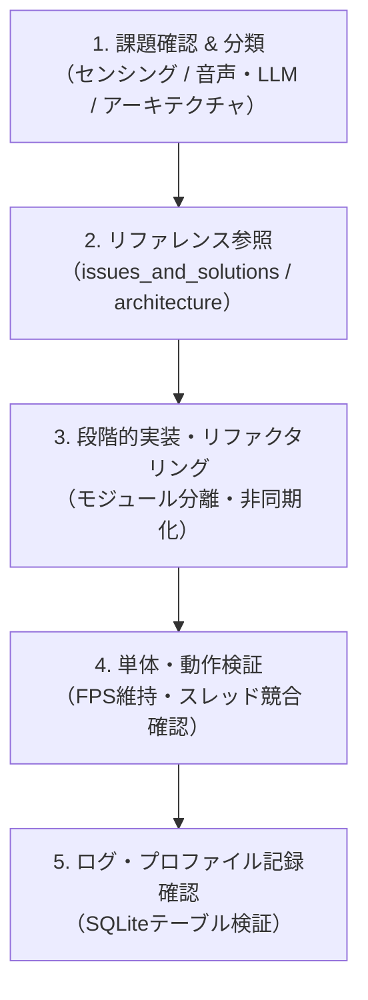

# Mobility AI Developer Skill

AI居眠り検知＆マルチモーダル対話型運転支援システム（`mobility_new`）の開発、リファクタリング、性能改善、トラブルシューティングを効率的に実行するためのスキルです。

---

## 1. システム全体概要

本システムは以下の5つの主要コンポーネントで構成されています：
1. **映像解析エンジン**: MediaPipe Face Meshを用いたEAR（眼開度比）および頭部姿勢（Pitch/Roll）による居眠り判定
2. **対話エージェント**: 音声認識（STT）、ローカルLLM（Ollama / LLaMA 3）、音声合成（TTS）による運転支援
3. **位置情報・ナビゲーション**: GPS座標に基づく周辺スポット（コンビニ・PA）の提示とLeaflet.js地図描画
4. **Webダッシュボード**: Flaskによるリアルタイム映像ストリーミング（MJPEG）と危険アラートUI
5. **データ永続化**: SQLiteによるユーザープロファイルと走行時時系列ログの記録

---

## 2. 開発・課題解決ワークフロー

本プロジェクトの開発や課題解決を行う際は、以下のステップに従ってください。

### ステップ 1: 課題の特定とリファレンスの確認
- 実装・改修に着手する前に、現状の既知課題と対応方針を確認してください：
  - [現状の課題と解決策](./references/issues_and_solutions.md)
  - [アーキテクチャ設計・リファクタリング方針](./references/architecture_refactoring.md)

### ステップ 2: 実装時の重要ルール
1. **メインループのFPS保護**:
   - カメラフレーム生成ループ（`generate_frames`）内で重い同期処理（LLM呼び出し、音声認識待ち、TTS再生）を直接実行してはならない。必ず非同期スレッドまたはキュー経由で行うこと。
2. **Windows COM初期化のルール**:
   - `pyttsx3` を使用するスレッドでは、必ず `pythoncom.CoInitialize()` と `pythoncom.CoUninitialize()` を適切に管理するか、専用の単一TTSワーカースレッドに処理を集約すること。
3. **安全第一のフェイルセーフ設計**:
   - 高危険度（スコア40超または急激な閉眼）検知時は、LLMの応答を待たずに即時アラートを発報すること。
4. **ハルシネーションの防止**:
   - Ollamaへのプロンプトには、架空店舗の生成を禁止し、短文・明瞭な日本語で返す制約を常に含めること。

---

## 3. よくあるエラーと対処法（トラブルシューティング）

### Q1. カメラの映像ストリーミングがカクつく、またはフリーズする
- **原因**: 対話エージェントやTTS処理がメインスレッド/ジェネレータ関数をブロックしている可能性があります。
- **対処法**: 対話呼び出しを `queue.Queue` を介した独立スレッドに逃がし、ブロッキングを解除してください。

### Q2. 音声合成（pyttsx3）が途中で喋らなくなる（COMエラー）
- **原因**: 複数スレッドから `pyttsx3.init()` が重複して呼び出されているか、COMコンテキストが終了していることが原因です。
- **対処法**: [アーキテクチャ設計書](./references/architecture_refactoring.md) に記載の「TTSワーカーの常駐化パターン」を適用してください。

### Q3. 音声認識（SpeechRecognition）が環境音でタイムアウトする
- **原因**: マイク入力の環境ノイズレベルに対して `energy_threshold` が不適切です。
- **対処法**: `r.adjust_for_ambient_noise(source, duration=0.5)` を適切に行い、失敗時のフォールバック先を固定文字（"ラーメン"）ではなく文脈に応じた案内メッセージに変更してください。

---

## 4. 完了基準チェックリスト（Definition of Done）

改修完了時は以下をすべて満たしているか確認してください：
- [ ] カメラ映像ストリーミングが遅延なくスムーズに描画されているか（30fps以上）
- [ ] 居眠り検知スコアの上昇・下降が正常に動作しているか
- [ ] 音声対話中もカメラ映像が停止しないか
- [ ] Windows COMエラーやスレッドデッドロックが発生していないか
- [ ] SQLiteへのログ保存（`detailed_logs`）が欠損なく行われているか

## 居眠り検知の精度改善 【対応完了 ✅】
- [x] 少し首を傾けただけで警告を出してしまう -> 相対姿勢キャリブレーション（ΔPitch/ΔRoll）を導入し平常角度を基準化
- [x] 目を薄めたときに警告を出してしまう -> 連続閉眼トラッキング（1〜8フレームの瞬きは無害化、1.2秒以上の長閉眼のみ緊急判定）
- [x] 一度警告を出すとNORMALに戻っても警告が出続ける -> 対話中もセンシングを常時継続し、開眼時にスコアを高速回復（-1.5/frame）

## マルチモーダル対話の精度改善 【対応完了 ✅】
- [x] 音声認識がうまくいかないと「近くの休憩所」や「コンビニ」などと返してしまう -> 捏造フォールバックを完全撤廃。「うまく聞き取れませんでした」と自然に聞き返し、2回無言なら終了
- [x] LLMが架空のコンビニを提案してしまう -> 実在3大チェーン（セブン/ローソン/ファミマ）または普通名詞「近くのコンビニ」のみにプロンプト制限
- [x] LLMが長文で返してしまい、運転中に聞き取れない -> プロンプト制約＋Python側ガードレール（`sanitize_ai_response`）で最初の1文（40文字以内）に強制カット
- [x] LLMがハルシネーションしてしまう -> `temperature=0.1` の決定論的設定、前置き（「AI:」等）の自動トリミング、状況連動フォールバック実装