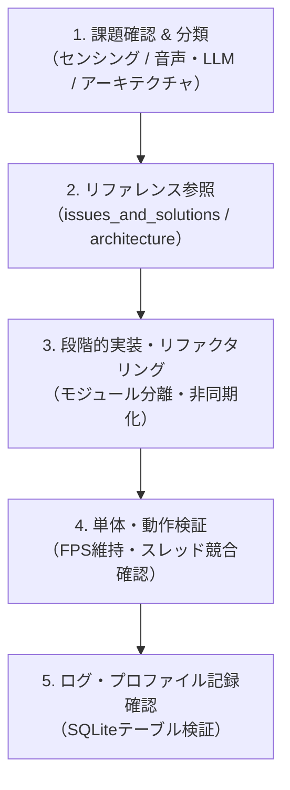

# Mobility AI Developer Skill

AI居眠り検知＆マルチモーダル対話型運転支援システム（`mobility_new`）の開発、リファクタリング、性能改善、トラブルシューティングを効率的に実行するためのスキルです。

---

## 1. システム全体概要

本システムは以下の5つの主要コンポーネントで構成されています：
1. **映像解析エンジン**: MediaPipe Face Meshを用いたEAR（眼開度比）および頭部姿勢（Pitch/Roll）による居眠り判定
2. **対話エージェント**: 音声認識（STT）、ローカルLLM（Ollama / LLaMA 3）、音声合成（TTS）による運転支援
3. **位置情報・ナビゲーション**: GPS座標に基づく周辺スポット（コンビニ・PA）の提示とGoogle Mapsルート案内
4. **Webダッシュボード**: Flaskによるリアルタイム映像ストリーミング（MJPEG）と危険アラートUI
5. **データ永続化**: SQLiteによるユーザープロファイルと走行時時系列ログの記録

---

## 2. 開発・課題解決ワークフロー

本プロジェクトの開発や課題解決を行う際は、以下のステップに従ってください。

### ステップ 1: 課題の特定とリファレンスの確認
- 実装・改修に着手する前に、現状の既知課題と対応方針を確認してください：
  - [現状の課題と解決策](./references/issues_and_solutions.md)
  - [アーキテクチャ設計・リファクタリング方針](./references/architecture_refactoring.md)

### ステップ 2: 実装時の重要ルール
1. **メインループのFPS保護**:
   - カメラフレーム生成ループ（`generate_frames`）内で重い同期処理（LLM呼び出し、音声認識待ち、TTS再生）を直接実行してはならない。必ず非同期スレッドまたはキュー経由で行うこと。
2. **Windows COM初期化のルール**:
   - `pyttsx3` を使用するスレッドでは、必ず `pythoncom.CoInitialize()` と `pythoncom.CoUninitialize()` を適切に管理するか、専用の単一TTSワーカースレッドに処理を集約すること。
3. **安全第一のフェイルセーフ設計**:
   - 高危険度（スコア40超または急激な閉眼）検知時は、LLMの応答を待たずに即時アラートを発報すること。
4. **ハルシネーションの防止**:
   - Ollamaへのプロンプトには、架空店舗の生成を禁止し、短文・明瞭な日本語で返す制約を常に含めること。

---

## 3. よくあるエラーと対処法（トラブルシューティング）

### Q1. カメラの映像ストリーミングがカクつく、またはフリーズする
- **原因**: 対話エージェントやTTS処理がメインスレッド/ジェネレータ関数をブロックしている可能性があります。
- **対処法**: 対話呼び出しを `queue.Queue` を介した独立スレッドに逃がし、ブロッキングを解除してください。

### Q2. 音声合成（pyttsx3）が途中で喋らなくなる（COMエラー）
- **原因**: 複数スレッドから `pyttsx3.init()` が重複して呼び出されているか、COMコンテキストが終了していることが原因です。
- **対処法**: [アーキテクチャ設計書](./references/architecture_refactoring.md) に記載の「TTSワーカーの常駐化パターン」を適用してください。

### Q3. 音声認識（SpeechRecognition）が環境音でタイムアウトする
- **原因**: マイク入力の環境ノイズレベルに対して `energy_threshold` が不適切です。
- **対処法**: `r.adjust_for_ambient_noise(source, duration=0.5)` を適切に行い、失敗時のフォールバック先を固定文字（"ラーメン"）ではなく文脈に応じた案内メッセージに変更してください。

---

## 4. 完了基準チェックリスト（Definition of Done）

改修完了時は以下をすべて満たしているか確認してください：
- [ ] カメラ映像ストリーミングが遅延なくスムーズに描画されているか（30fps以上）
- [ ] 居眠り検知スコアの上昇・下降が正常に動作しているか
- [ ] 音声対話中もカメラ映像が停止しないか
- [ ] Windows COMエラーやスレッドデッドロックが発生していないか
- [ ] SQLiteへのログ保存（`detailed_logs`）が欠損なく行われているか

## 居眠り検知の精度改善 【対応完了 ✅】
- [x] 少し首を傾けただけで警告を出してしまう -> 相対姿勢キャリブレーション（ΔPitch/ΔRoll）を導入し平常角度を基準化
- [x] 目を薄めたときに警告を出してしまう -> 連続閉眼トラッキング（1〜8フレームの瞬きは無害化、1.2秒以上の長閉眼のみ緊急判定）
- [x] 一度警告を出すとNORMALに戻っても警告が出続ける -> 対話中もセンシングを常時継続し、開眼時にスコアを高速回復（-1.5/frame）

## マルチモーダル対話の精度改善 【対応完了 ✅】
- [x] 音声認識がうまくいかないと「近くの休憩所」や「コンビニ」などと返してしまう -> 捏造フォールバックを完全撤廃。「うまく聞き取れませんでした」と自然に聞き返し、2回無言なら終了
- [x] LLMが架空のコンビニを提案してしまう -> 実在3大チェーン（セブン/ローソン/ファミマ）または普通名詞「近くのコンビニ」のみにプロンプト制限
- [x] LLMが長文で返してしまい、運転中に聞き取れない -> プロンプト制約＋Python側ガードレール（`sanitize_ai_response`）で最初の1〜2文（60文字以内）に強制カット
- [x] LLMがハルシネーションしてしまう -> `qwen2.5:7b` モデルの採用、Few-Shot具体例の導入、`temperature=0.0` の決定論的設定、前置きトリミング、状況連動フォールバック実装
- [x] 眠気検知時に一方的な警告命令のみで提案が返ってこない -> 「今何か食べたいものや寄りたい休憩スポットはありますか？」と質問を投げかけ、ドライバーの返答（コーヒー/コンビニ/ラーメン/仮眠等）に応じた実在スポットの選定とLeaflet地図上でのルートナビゲーション案内（OSRM経路線・目的地ピン・所要時間）を完全連動実装 ✅

## トラブルシューティング（既知の事象と解決策）

### 1. カメラ映像上のテキストが「?」に文字化けする問題

**【事象】**
カメラ映像（HUD）にステータスを描画する際、日本語部分が `DANGER (??????????????)` のように「?」マークに文字化けして表示されてしまう。

**【原因】**
映像へのテキスト描画に使用している OpenCV の `cv2.putText()` 関数が、標準では日本語（マルチバイト文字）に対応していないためです。OpenCVの内蔵フォント（`cv2.FONT_HERSHEY_SIMPLEX` など）は英数字のみをサポートしているため、日本語を渡すと描画できずに文字化けが発生します。

**【解決策】**
以下のいずれかの方法で対応します。リアルタイム処理の負荷を軽く保つため、基本的には「対応策A」を推奨します。

#### 対応策A：英語表記に変更する（推奨）
プログラム内の状態テキストをすべて英語表記に変更します。これにより、標準のOpenCVフォントのまま文字化けせずに描画可能です。

### 2. 居眠りスコアが100以上の数値を出してしまう問題 【対応完了 ✅】

**【事象】**
居眠りスコアが上限の100を超えて `168/100` や `200/100` などの異常値を表示してしまう。

**【原因】**
`generate_frames` 内で連続閉眼やあくび、姿勢の乱れを検出した際に `state.score` へ加算する処理がある一方、100.0で上限クランプ（制限）する処理が存在しなかったため、閉眼が続くと青天井にスコアが増加していました。

**【解決策】**
- `main.py` の判定ループ末尾で `state.score = float(np.clip(state.score, 0.0, 100.0))` を適用し、0〜100の範囲内に厳密にクランプ。
- `/api/status` エンドポイントおよび WebUI（`index.html`）側でも `Math.min(100, Math.max(0, ...))` による多重防御を実施。

---

### 3. ドライバーカメラを切断しても「接続中」と表示され続ける問題 【対応完了 ✅】

**【事象】**
カメラのUSBを抜いたり映像が停止しても、ダッシュボード上のバッジが「接続中」のまま緑色で表示され続ける。

**【原因】**
- HTML上の `接続中` が固定表示のままで、JavaScript側で状態を更新するロジックが存在しなかった。
- バックエンド側でもカメラのフレーム取得成否（`camera_connected`）や直近フレーム受信時刻（`last_frame_time`）を管理・配信していなかった。

**【解決策】**
1. **バックエンド（`main.py`）**:
   - `SystemState` に `camera_connected` と `last_frame_time` を追加。
   - `cap.read()` 成功時に `True` と現在時刻を記録、失敗時や終了時は `False` に更新。
   - `/api/status` で直近2秒以内にフレーム受信があるかを判定し `"camera_connected": boolean` を返却。
2. **フロントエンド（`index.html`）**:
   - 定期ポーリングで `data.camera_connected` を監視し、`接続中`（緑）と `未接続 / 切断`（赤・点滅）を動的に切り替え。
   - カメラ切断時は映像エリアに「カメラ未接続 / 切断中」オーバーレイを表示。
   - `` に `onerror` ハンドラを追加し、ストリーム途絶時にも即座に切断状態へ移行。

---

### 4. カメラが起動しない・ストリーミングが始まらない問題 【対応完了 ✅】

**【事象】**
Webダッシュボード起動時にカメラ映像が表示されず、映像ストリーミングが開始されない、または起動直後にエラーとなる。

**【原因】**
1. `main.py` の `generate_frames()` 内で、`while True:` ループの直後にある画像解析・エンコード処理（`rgb_frame = cv2.cvtColor(...)` から `yield` まで）のインデントが浅くなっており、ループ外に配置されていた（`while True:` 内で `cap.read()` だけが無限ループし、ブラウザへフレームが1枚も yield されない構造だった）。
2. 顔未検出時に `landmarks` を参照して `NameError` や `UnboundLocalError` が発生する潜在的不具合が存在した。
3. Windows コンソール（cp932）環境において、絵文字（✅, 🚨 など）を含む `print()` が実行されると `UnicodeEncodeError` でプロセスがクラッシュする問題が存在した。
4. Windows 環境下で `cv2.VideoCapture(0)` の初期化に時間がかかる、あるいはデバイスインデックスが一致しない場合があった。

**【解決策】**
1. **ループ構造の修正**: `while True:` 内に顔認識・HUD描画・JPEGエンコード・`yield` までの全フローを正しくインデント。顔未検出時も安全に「顔を検出中...」HUDを描画して毎フレーム確実に配信。
2. **Windows環境への最適化 (`get_camera_capture`)**: DirectShow (`cv2.CAP_DSHOW`) を優先し、インデックス 0 と 1 を自動フォールバック探索して高速・確実にカメラをオープン。
3. **UnicodeEncodeError 防止**: `sys.stdout.reconfigure(encoding='utf-8')` の設定と、コンソールログ用絵文字を ASCII プレフィックス（`[OK]`, `[ALERT]`, `[WARN]`）に統一。
