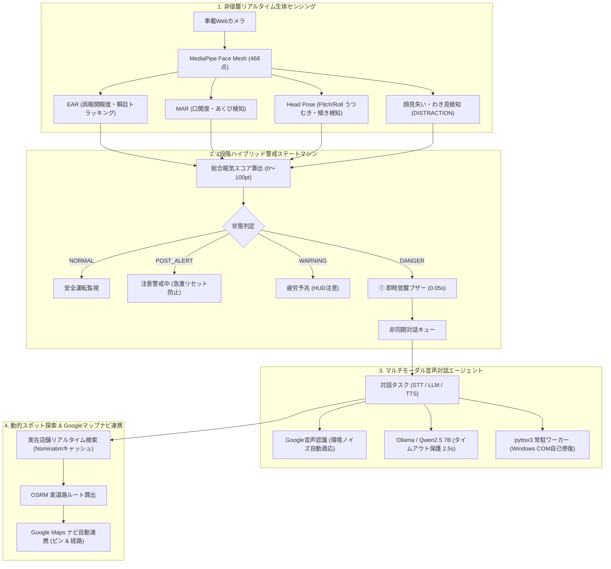

# 🚗 AI居眠り検知＆マルチモーダル対話型運転支援システム
### Next-Gen AI Driver Monitoring & Multimodal Safety Assistant (`mobility_new`)

[](https://www.python.org/)
[](https://opencv.org/)
[](https://developers.google.com/mediapipe)
[](https://ollama.com/)
[](https://flask.palletsprojects.com/)
[](#)

実車・車載端末への搭載を前提とした、**次世代型エッジAI運転支援・居眠り防止対話アシスタント**です。  
車載カメラを通じてドライバーの表情・視線・頭部姿勢をリアルタイムに非侵襲センシングし、眠気や疲労をミリ秒単位で検知します。

従来の「一方的に警告音を鳴らして休憩を命令する」システムとは異なり、**ドライバーの生理的・心理的状態に寄り添い、希望する店舗や休憩スポット（カフェ、コンビニ、ラーメン、道の駅など）を完全ハンズフリーの音声対話でヒアリングし、現在地から最寄りの実在店舗へGoogleマップを通じて自動誘導**します。

---

## 🌟 主な特徴・機能（Key Features）



### 1. 👁️ 高精度・非侵襲 リアルタイム生体センシング
- **MediaPipe Face Mesh (468点)**: 顔面特徴点からミリ秒単位でピクセル実距離を幾何計算。
- **EAR（Eye Aspect Ratio: 両眼開眼度比）**: 1〜8フレームの自然な瞬きは無害化し、緩慢瞬目や1.2秒以上の持続閉眼のみを即座にキャッチ。
- **MAR（Mouth Aspect Ratio: 口開度比）**: 口角と唇の比率からあくびを捉え、居眠りの予兆段階（WARNING）で介入。
- **頭部姿勢推定（Pitch / Roll）**: 三角幾何演算による高速・安定したうつむき・脱力傾き検知。
- **動的適応キャリブレーション**: 起動時の平常値学習に加え、走行中の環境光・カメラ自動露出変化へEMA（指数移動平均）で自動追従。
- **わき見・脱力検知（DISTRACTION）**: 顔未検出が2秒以上継続した場合に前方注意を発報、4秒継続で危険警告。

### 2. 🛡️ 安全第一の2段階ハイブリッド警告 & 不感帯防止
- **遅延ゼロ（0.05秒）即時警告ブザー**: 居眠り検知（DANGER）瞬間に高周波2200Hzブザー（`winsound`）を鳴らし、ドライバーを即座に覚醒。
- **警戒空白期間の排除（POST_ALERTフェーズ）**: 対話終了直後にスコアを0リセットせず、警戒スコア（25pt）を維持して開眼推移に応じた自然減衰を行うことで、無防備な空白期間を完全解消。

### 3. 🎙️ 完全ハンズフリー 音声対話エージェント（HMI）
- **ローカルLLM（Ollama / Qwen2.5 7B）**: 前置きのない簡潔・温かい発話（60文字以内）を生成。
- **タイムアウト保護機構（2.5秒）**: LLM推論の遅延を監視し、タイムアウト時は直ちに安全なフォールバック音声で案内を継続。
- **常駐型TTSエンジン**: Windows COM（SAPI5）競合クラッシュを防ぐ専用ワーカースレッド＆クラッシュ時自動再初期化。
- **対話キューによるFPS保護**: カメラのフレーム処理ループから重い音声処理を完全に分離し、映像30fpsを常時維持。

### 4. 🗺️ 全国対応 動的スポット探索 & Google Mapsナビゲーション
- **自由発話からの目的地抽出**: 「近くのセブンに行きたい」「ラーメン食べたい」「休みたい」「お願いします」等から意図と名詞を正確に解析。
- **インメモリキャッシュ付き Nominatim API**: OpenStreetMapを活用した周辺実店舗検索（店名・緯度経度・距離）。キャッシュ機構でAPI制限（HTTP 429）や遅延を防止。
- **OSRM 実道路ルート案内**: 実際の走行ルート座標を取得し、Leaflet/Googleマップへリアルタイム描画。ワンクリックで車載Google Mapsアプリのナビ起動が可能。

### 5. 📊 車載向けサイバーダーク Webダッシュボード
- **テレメトリリアルタイム表示**: 開眼度（EAR）、あくび開度（MAR）、頭部傾き（Pitch）、総合スコア（0〜100pt）を常時可視化。
- **走行・生体ログ履歴モーダル**: SQLite（非同期直列書き込み）に蓄積された直近のイベントログを画面上で即座に確認可能。

---

## 🏗️ システム構成・アーキテクチャ

```
mobility_new/
├── core/                        # システム共通基盤
│   ├── config.py                # 定数・日本語フォント描画設定
│   └── state.py                 # グローバルシステム状態管理（SystemState）
├── sensing/                     # 映像解析 & センシングエンジン
│   └── face_tracker.py          # MediaPipe Face Mesh、EAR/MAR、姿勢推定、MJPEG配信
├── voice/                       # 音声処理 & 対話エージェント
│   ├── tts_engine.py            # pyttsx3 常駐ワーカー & 即時警告ブザー
│   └── dialog_agent.py          # Ollama (タイムアウト保護付き) & STT対話
├── navigation/                  # ナビゲーション & 地図連携
│   └── spot_navigator.py        # スポット動的解決、キャッシュ付きNominatim/OSRM検索
├── storage/                     # データ永続化
│   └── db_manager.py            # SQLite非同期書き込みワーカー & ログ取得
├── templates/
│   └── index.html               # 車載向けWebダッシュボード (Tailwind CSS, Google Maps)
├── main.py                      # Flask Webサーバー & APIエントリーポイント
├── test_system.py               # ユニット・統合テストスイート
└── mobility_advanced.db         # SQLiteデータベース
```

---

## 💻 動作要件（Prerequisites）

- **OS**: Windows 10 / 11 (64-bit)
- **Python**: 3.10 以上
- **ハードウェア**:
  - Webカメラ（または車載USBカメラ）
  - マイク & スピーカー
- **ローカルLLM環境**: [Ollama](https://ollama.com/) がインストールされ、バックグラウンド起動していること

---

## 🚀 セットアップ手順（Installation）

### 1. リポジトリのクローン
```bash
git clone https://github.com/haru7175/drowsiness-detection-system.git
cd drowsiness-detection-system
```

### 2. 仮想環境の作成とライブラリのインストール
```powershell
# 仮想環境の作成と有効化
python -m venv env
.\env\Scripts\activate

# 必要パッケージのインストール
pip install opencv-python mediapipe flask pyttsx3 SpeechRecognition requests numpy pillow python-dotenv ollama pywin32
```

### 3. Ollama のセットアップとモデルの準備
本システムは高速・高精度な日本語対応モデル `qwen2.5:7b` を推奨しています。
```powershell
# モデルのダウンロード
ollama pull qwen2.5:7b
```

### 4. 環境変数の設定（任意）
Google Maps JavaScript API キーを利用する場合は、プロジェクトルートに `.env` ファイルを作成してください。  
（APIキーがない場合も、自動的にGoogle Maps Embedフォールバックモードで地図が表示されます）

```env
GMAPS_API_KEY=your_google_maps_api_key_here
```

---

## 🚦 実行方法（Usage）

### システムの起動
```powershell
.\env\Scripts\python main.py
```

1. 起動後、自動的にブラウザで [http://127.0.0.1:5000](http://127.0.0.1:5000) が開きます。
2. カメラが起動し、最初の100フレームで**「正面を向いて目を開けてください」**とガイダンスが表示され、個人特性に合わせたキャリブレーションが行われます。
3. キャリブレーション完了後、リアルタイム監視が開始されます。

### テスト・動作検証
```powershell
# ユニット・統合テストの実行
.\env\Scripts\python test_system.py
```

---

## 🧪 テスト・安全機能の体験方法

- **居眠り検知（長閉眼）**:
  - 1秒以上目を閉じると、居眠りスコアが急上昇し、40ptを超えた瞬間に「警告ブザー（2200Hz Beep）」が鳴り、AIアシスタントが「意識は大丈夫ですか？少しお疲れのようです...」と話しかけてきます。
- **あくび検知**:
  - 口を大きく開けるとMAR（口開度比）が上昇し、あくびとしてカウントされ疲労スコアに加算されます。
- **わき見・脱力検知**:
  - 顔をカメラの画角から外すか下を向いて2秒以上経過すると、紫色バッジ「DISTRACTION（わき見・脱力）」が表示されます。
- **音声対話 & ナビ連携**:
  - AIからの問いかけに対して「近くのコンビニに行きたい」「スタバ」「ラーメン食べたい」などと発話（または画面下のテキスト入力から送信）すると、現在地周辺の実店舗が選定され、Googleマップ上にルート案内が自動展開されます。
  - 「大丈夫」「平気」と答えると、案内を終了して通常監視に戻ります。
- **走行ログの確認**:
  - 画面右上の「走行ログ」ボタンをクリックすると、過去の判定ログ・アクション履歴を確認できます。

---

## 📄 ライセンス（License）

本プロジェクトは [MIT License](LICENSE) のもとで公開されています。
