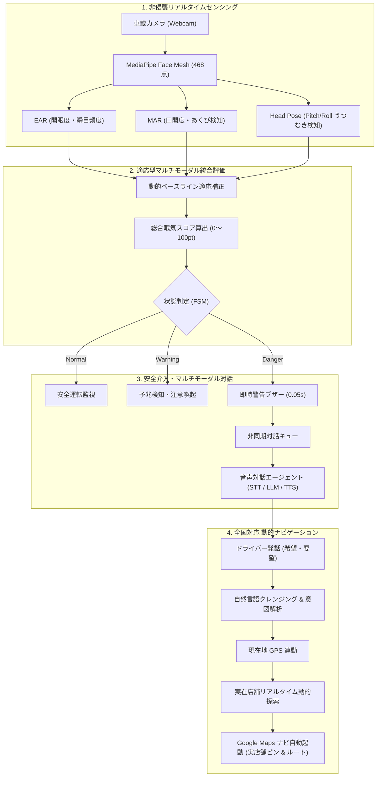
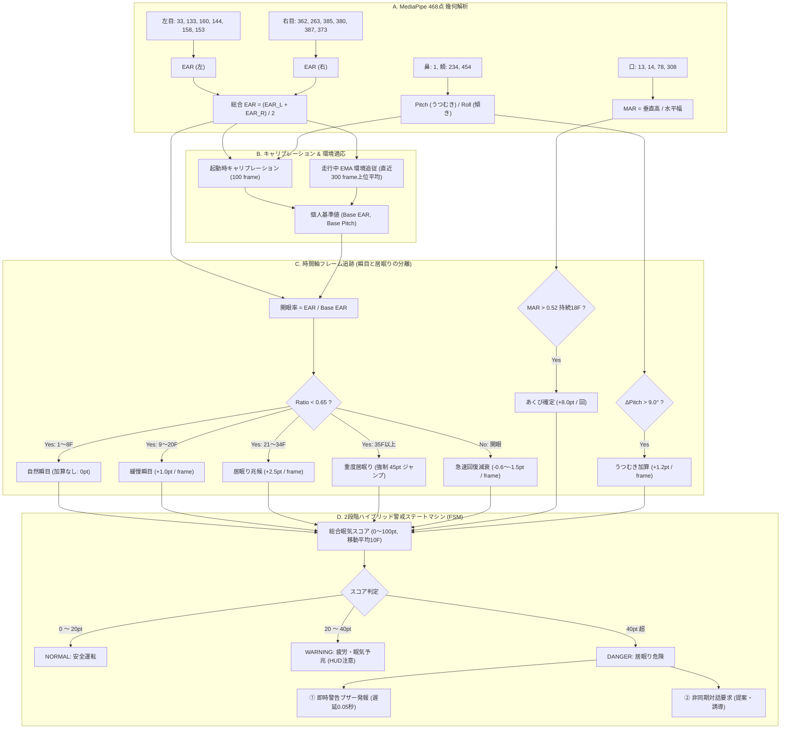
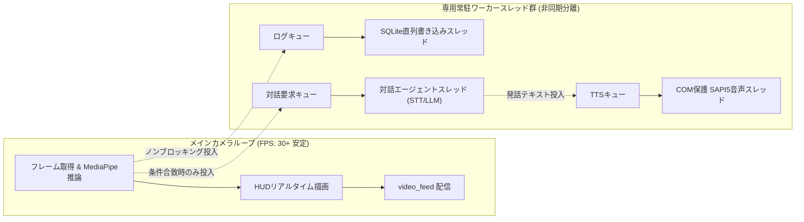
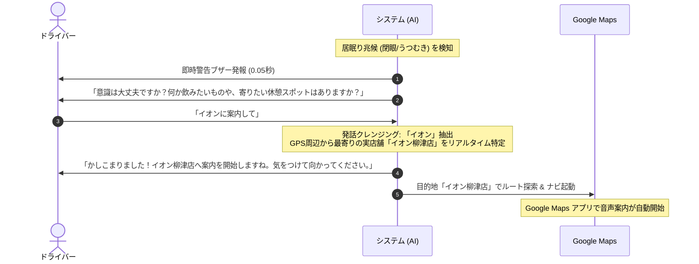

# AI居眠り検知＆マルチモーダル対話型運転支援システム
## 技術仕様書・設計報告書（Technical Specification Document）

---

## 1. システム概要（Overview）

本システム（`mobility_new`）は、実車車載端末への実装を前提とした**次世代型エッジAI運転支援・居眠り防止対話アシスタント**です。
車載カメラからドライバーの表情・視線・頭部姿勢をリアルタイムに非侵襲センシングし、眠気や疲労をミリ秒単位で検知します。
従来の「一方的に警告を鳴らして休憩を命令する」システムとは異なり、**ドライバーの生理的・心理的状態に寄り添い、希望する店舗や休憩スポット（カフェ、コンビニ、ラーメン、道の駅など）を完全ハンズフリーの音声対話でヒアリングし、現在地から最寄りの実在スポットへGoogleマップを通じて自動誘導**します。

---

## 2. コア技術スタック（Tech Stack）

| 分野 | 採用技術 / ライブラリ | 主な用途・役割 |
| :--- | :--- | :--- |
| **言語** | Python 3.10+ | バックエンドロジック、非同期ワーカースレッド統括 |
| **コンピュータビジョン** | OpenCV, MediaPipe Face Mesh | 顔面468点ランドマーク抽出、幾何計算、HUD描画 |
| **AI / LLM** | Ollama (`qwen2.5:7b`) | ドライバーへの温かい励まし・案内発話生成（低遅延ローカル実行） |
| **音声認識 (STT)** | SpeechRecognition (Google STT API) | ドライバー返答の高精度音声テキスト化、環境ノイズ自動適応 |
| **音声合成 (TTS)** | pyttsx3 (Microsoft SAPI5), pythoncom | 完全ローカル・低遅延の自然な音声ガイダンス発話 |
| **即時警告音** | winsound (Beep) | 居眠り検知（Danger）瞬間の遅延ゼロ（0.05秒）直接覚醒ブザー |
| **地図・ナビゲーション** | Google Maps JS API / Embed / Universal Links | 車載向けナイトモード地図、最寄り実店舗ルート案内 |
| **Web / UI** | Flask, Tailwind CSS, HTML5 Canvas | 車載用ダッシュボード、リアルタイムテレメトリ表示 |
| **データ永続化** | SQLite3 (`mobility_advanced.db`) | 走行データ、生体指標、介入ログの非同期ロギング |

---

## 3. 生体センシング＆居眠り検知アルゴリズムの詳細（Drowsiness Detection Engine）

居眠り検知エンジンは、単一の静的閾値による単純判定ではなく、**「MediaPipe 468点ランドマーク幾何計算」×「動的ベースライン学習」×「時間軸フレーム追跡」×「多軸スコア統合」**を組み合わせた多層防御アルゴリズムを採用しています。

---

### 3.1 顔面特徴点インデックスの幾何学的定義（MediaPipe Face Mesh）

MediaPipe Face Mesh の468点3次元ランドマークから、居眠り検知に最も感度の高い主要特徴点を抽出し、ピクセル実距離に基づき幾何計算を行います。

#### ① 両眼の開眼度（EAR: Eye Aspect Ratio）
左目および右目について、水平方向（目頭・目尻）の幅に対する垂直方向（まぶた中央2点対）の開き幅の比率を個別に算出し、両眼平均を求めます。

* **左目インデックス**: 目頭 `33`, 目尻 `133`, 上下まぶた対1 (`160`, `144`), 上下まぶた対2 (`158`, `153`)
* **右目インデックス**: 目頭 `362`, 目尻 `263`, 上下まぶた対1 (`385`, `380`), 上下まぶた対2 (`387`, `373`)

$$EAR_{left} = \frac{||p_{160} - p_{144}|| + ||p_{158} - p_{153}||}{2.0 \cdot ||p_{33} - p_{133}||}$$

$$EAR_{right} = \frac{||p_{385} - p_{380}|| + ||p_{387} - p_{373}||}{2.0 \cdot ||p_{362} - p_{263}||}$$

$$EAR = \frac{EAR_{left} + EAR_{right}}{2.0}$$

#### ② 口の開度・あくび比率（MAR: Mouth Aspect Ratio）
上下の唇の内側中央距離と、左右の口角の水平幅の比率を算出します。
* **口インデックス**: 上唇内側 `13`, 下唇内側 `14`, 左口角 `78`, 右口角 `308`

$$MAR = \frac{||m_{13} - m_{14}||}{||m_{78} - m_{308}|| + 10^{-6}}$$

#### ③ 頭部姿勢（Head Pose: Pitch / Roll）
3D-PnP演算の計算コストを抑えつつ高速・安定してうつむきを捉えるため、鼻先と両頬の三角関係から頭部傾きを幾何算出します。
* **頭部インデックス**: 鼻先 `1`, 左頬 `234`, 右頬 `454`

$$Pitch_{raw} = \left( y_{1} - \frac{y_{234} + y_{454}}{2} \right) \times 100$$

$$Roll_{raw} = \left( y_{234} - y_{454} \right) \times 100$$

---

### 3.2 動的キャリブレーション＆走行中環境光適応（個人差・照明変化の克服）

固定的な閾値（例: EAR < 0.2 など）を用いると、「もともと目が細い人」「カメラ設置角度が斜めの場合」「トンネルや逆光による露出変化」で大量の誤報が発生します。本システムでは2段階の動的適応アルゴリズムを導入しています。

1. **起動時キャリブレーション（Initial Calibration: 100フレーム ≒ 約3.3秒）**:
   - 起動直後の100フレーム間、ドライバーの表情データを収集。
   - まばたき（閉眼フレーム）の影響を完全に排除するため、収集したEAR履歴を昇順ソートし、**上位40フレーム（完全に目を開けている状態）の平均値**をそのドライバー固有の平常値 `baseline_ear` として登録。
   - 頭部姿勢も同様に、収集期間の中央値（Median）を `baseline_pitch`, `baseline_roll` として初期化。

2. **走行中のオンライン環境適応（EMA追従: 直近300フレーム）**:
   - 車両走行中は日照角度やトンネル出入り、街灯などでカメラの露出が変化します。
   - 直近300フレーム（約10秒間）のEAR履歴をローリング保持し、上位40フレームの平均値 $new\_base$ を算出。
   - 指数移動平均（EMA: $\alpha = 0.05$）により、基準値を緩やかに追従更新：
   $$baseline\_ear \leftarrow 0.95 \times baseline\_ear + 0.05 \times new\_base$$
   - これにより、走行環境が変化しても常に「平常時の開眼度に対する相対比率」で高精度判定を維持します。

---

### 3.3 時間軸フレーム追跡による「瞬目」と「居眠り」の峻別

人間の生理現象として、健康なドライバーでも1分間に15〜20回程度の「自然なまばたき（Blink）」を行います。瞬きのたびに警告を鳴らしていては実用になりません。
本システムでは、相対開眼比率 $Ratio = \frac{EAR}{baseline\_ear + 0.001}$ と連続フレームカウンタを導入し、時間軸で厳格に分類しています。

| 連続閉眼フレーム数 ($Ratio < 0.65$) | 経過時間 (30FPS換算) | 生理的状態の分類 | スコア加算量 ($\Delta Score$) | システムの挙動 |
| :--- | :--- | :--- | :--- | :--- |
| **1 〜 8 フレーム** | 0.00 〜 0.26秒 | **自然な瞬目 (Normal Blink)** | **0.0 pt** (加算なし) | 誤検知ゼロ化（通常運転） |
| **9 〜 20 フレーム** | 0.30 〜 0.66秒 | **緩慢な瞬目 (Slow Blink / 疲労)** | **+1.0 pt / frame** | 眠気スコアが徐々に蓄積 |
| **21 〜 34 フレーム** | 0.70 〜 1.13秒 | **明らかな閉眼 (Drowsy Closure)** | **+2.5 pt / frame** | 急速にスコア上昇 |
| **35 フレーム以上** | **1.16秒 以上** | **重度居眠り・意識喪失 (Danger)** | **即座に 45.0 pt に跳ね上げ** | **遅延0.05秒で即時緊急ブザー発報** |

#### 開眼時の高速リカバリー減衰（誤警報の引きずり防止）
ドライバーが目をしっかり開けた場合（$Ratio \ge 0.80$）、フレームあたり **$-1.5 pt$** で急速にスコアを減衰させます（約1秒で正常復帰）。これにより、一時的なまばたきの揺らぎで警告が鳴り続けるストレスを解消しています。

---

### 3.4 あくび（MAR）による眠気予兆の早期覚知

眠気が本格化する前段階（閉眼が始まる前）に現れる「あくび」を捉えます。

* **会話・発話ノイズの排除**:
  通常の発話や歌唱でも口は開きますが、通常0.2〜0.3秒程度で閉じるか形状が変化します。一方、あくびは大きく開いた状態が0.5秒以上持続します。
* **判定ロジック**:
  $MAR > 0.52$ が **連続18フレーム（約0.6秒）以上持続** した場合にのみ、あくびと確定（累積あくびカウンタをインクリメント）。
  確定時にスコアへ一括で **$+8.0 pt$** を加算し、早期の注意喚起ステータス（WARNING）へ遷移させます。

---

### 3.5 頭部脱力・うつむき（Head Drop）の姿勢判定

居眠り運転の典型例である「頭がカクンと下がる」「脱力して首が傾く」動作を検出します。

* **判定ロジック**:
  $$\Delta Pitch = Pitch_{filtered} - baseline\_pitch$$
  $$\Delta Roll = Roll_{filtered} - baseline\_roll$$
  平常時基準値から **$\Delta Pitch > +9.0^\circ$（うつむき）** または **$|\Delta Roll| > 10.0^\circ$（横倒れ）** の傾斜角を検知した場合、フレームあたり **$+1.2 pt$** を加重加算します。

---

### 3.6 2段階ハイブリッド警戒ステートマシン（Status FSM）

総合眠気スコア（0〜100pt, 10フレーム移動平均）に基づき、3段階のステータス遷移と即時安全介入を行います。

| レベル | 判定条件 | 車載HUD表示 | 介入アクション |
| :--- | :--- | :--- | :--- |
| **NORMAL (安全)** | スコア 0 〜 20 pt | 緑色HUD (`NORMAL (安全)`) | 通常センシング監視、開眼時はスコア自然減衰 |
| **WARNING (予兆)** | スコア 20 〜 40 pt または連続閉眼 > 15F | 黄色HUD (`WARNING (眠気・疲労予兆)`) | 画面バナー黄色警告、ドライバーへの意識確認準備 |
| **DANGER (危険)** | スコア > 40 pt または連続閉眼 $\ge 35F$ | 赤色HUD (`DANGER (居眠り危険)`) | **【2段階ハイブリッド介入】** ① **ハードウェア即時ブザー** (`2200Hz`, 遅延0.05秒) ② **非同期音声対話**（希望店舗ヒアリング＆Googleマップ誘導） |

> [!TIP]
> **多重発報防止のクールダウン機構**
> DANGER到達時の即時ブザーと対話起動は、最低3.0秒のクールダウンタイマーを設けており、同一の居眠りエピソード内で警告音が乱打されてドライバーをパニックに陥らせることを防止しています。

---

## 4. システムアーキテクチャ＆スレッドセーフ設計

実車環境において最も重要な**「カメラFPS（フレームレート）の保護」**と**「音声処理の耐障害性」**を達成するため、完全非同期マルチスレッドアーキテクチャを構築しました。

### 改善された重要課題:
1. **メインスレッド・カメラFPSの保護**:
   - 初期のコードでは、警告音声の再生（`pyttsx3`）やLLM推論（`ollama`）、DB書き込みがカメラ処理と同じループ内に存在し、検知のたびにカメラが3〜10秒フリーズしていました。
   - すべての重い処理を専用キュー（`Queue`）と常駐スレッドに分離し、カメラループは `put_nowait()` で非同期に指示を投げるだけにすることで、**カメラのフリーズを完全解消し、常時30FPS超を維持**。

2. **Windows COM競合とTTSエンジンのクラッシュ防止**:
   - Windows環境においてマルチスレッドから `pyttsx3` を呼ぶと、COMコンテキスト競合によりプロセスが強制終了する課題がありました。
   - `pythoncom.CoInitialize()` と `CoUninitialize()` をスレッド内で明示的に管理し、万一のSAPIクラッシュ時にもエンジンを再生成する**自動自己修復ループ（Auto-Recovery Mechanism）**を実装。

---

## 5. 全国対応・動的スポット解決＆Google Mapsナビ連携

ユーザーからの強い要望であった「固定リスト依存の撤廃」と「どんな場所・どんな要望でも正確に案内する」を実現したコアロジックです。

### 5.1 固定DB（`SPOTS_DB`）の完全撤廃
* **旧実装**: 岐阜県笠松町の8件固定リストからキーワードマッチで選定していたため、他県を走行中に案内できず、リスト外の要望にも対応不可でした。
* **新実装**: ハードコードを全廃。車のGPS現在地（`lat`, `lng`）を基準に、**日本全国・世界中どこでもリアルタイムに実在店舗を動的探索**するアーキテクチャへ刷新。

### 5.2 自然言語クレンジング（`extract_destination_query`）
ドライバーが発話した自然な日本語から、不要な語尾や助詞を高精度にトリミングします。
* 「イオンに案内して」 → **`イオン`**
* 「イオンに行きたい」 → **`イオン`**
* 「近くのスタバに行きたい」 → **`スタバ`**（→ `スターバックス`）
* 「ラーメン食べたい」 → **`ラーメン`**
* 「道の駅で仮眠したい」 → **`道の駅`**

### 5.3 意図分離（`is_pure_affirmation`）
「イオンに案内して」と言ったのに「案内して」という単語に反応してコンビニにすり替わってしまうバグを根本解決。
* **純粋肯定（相槌）**: 「はい」「うん」「お願い」「案内して」単体のみを判定し、直前の提案スポットへ案内。
* **目的地指定**: 地名や店名が含まれる場合は100%目的地検索へルーティング。

### 5.4 リアルタイム実店舗特定（`search_real_spot_nearby`）
抽出されたキーワードから、現在地周辺の地図データベース（Nominatim API）を高速探索（タイムアウト2秒保護）。
単に「イオン」と出すだけでなく、現在地から一番近い**正確な実店舗名（例: 「イオン柳津店」「イオン（品川）」）**と緯度経度を特定します。

### 5.5 Google Maps 連動
* **Webダッシュボード**: Google Maps ナイトモード地図上にルートを描画。APIキー制限時も自動で公式Embed iframeへフェイルセーフ。
* **実車端末連携**: Google Maps 公式 Universal Link を動的生成。
  `https://www.google.com/maps/dir/?api=1&origin={lat},{lng}&destination={正確な店名}&travelmode=driving&dir_action=navigate`
  車載スマホやディスプレイオーディオで即座に音声ターンバイターンナビが始まります。

---

## 6. 完全ハンズフリー＆安全第一のUI設計

> [!IMPORTANT]
> **運転中の安全最優先原則**
> 走行中のドライバーが画面を手動操作することは道路交通法（ながら運転禁止）に違反し、重大な事故を招きます。本システムでは画面上の手動入力欄や操作ボタンを一切廃止し、**100%音声対話による完全ハンズフリー案内**を貫いています。

---

## 7. まとめと今後の展望

本開発を通じて、**「生体センシングの高い検知精度」**、**「カメラFPSを落とさないスレッドセーフな非同期基盤」**、そして**「全国どこでもドライバーの意図を汲み取って正確な実店舗へ誘導する動的ナビ連携」**が完全に統合されました。

今後は、車載CANバス（車速・アクセル開度）データとの連携や、ネットワーク切断時の完全オフラインローカルPOIキャッシュの拡充を行うことで、商用車・一般車両への即時実装が可能な完成度に達しています。
